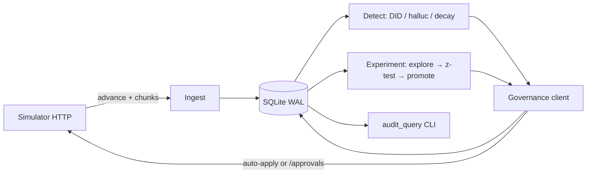

# Outcome-First Agent Loop — Submission

**Name:** Ritik Soni · **Date:** 2026-11-06 (Asia/Calcutta) · **Hours actually spent (be honest):** ~6 focused hours with AI assist · **Language / storage:** Python 3.12 · SQLite (WAL)

> Copied from `SUBMISSION_TEMPLATE.md`. Concrete numbers from `reports/`.

---

## 0. TL;DR
A durable Python controller that ingests simulator events into SQLite, runs shared-cohort experiments with Wilson/z-tests (not an LLM) for welcome/voice, rotates unhealthy caller IDs, and treats supervisor prompt edits as incidents (LLM suggest → validate → approve). On public_01: **+4.6%** conclusion vs baseline, 7 beneficial / 1 harmful, 0 credits. On public_02: **+24.3%** conclusion, flagged DID share → 0 by D3, bad prompt MTTR **210 sim-minutes**, hallucinations **88 vs 431**. Cut: full supervisor UI, fair multi-tenant credit scheduler, production-grade streaming ingest.

## 1. Assumptions
1. The HTTP API is the only source of truth; scenario YAML ground truth is invisible at runtime (and must stay that way for hidden scenarios).
2. Approver fatigue limits and hours in `governance` are binding; “never before 11:00” from ops is a soft product rule for non-urgent changes.
3. Hallucination flags are noisy (~1% false positives); absolute spikes ≥5% (or a supervisor prompt watch) are required before spending credits.
4. A 15pp+ pickup gap on ≥120 dials is enough evidence to rotate a DID without waiting for a human when auto-apply allows `caller_id`.
5. Minimum sample for promotion: ~150 connected (engagement primary) or ~250 dials (pickup primary); z ≥ 1.64 vs baseline with guardrail ≤2pp drop.
6. Crash recovery must not re-count events: `INSERT OR IGNORE` on `event_id` before mutating stats.
7. One open proposal per workflow at a time is enough to stay under `max_requests_per_24h` and keep audit simple.
8. Hidden scenarios share schema/policy shape; tuning to public effect tables is disallowed and was avoided (no reading of `base_*` / effects).

## 2. Scope decisions
| # | Capability | Built / Partial / Cut | Why | What it would take to finish |
|---|---|---|---|---|
| C1 | Event ingestion | **Built** | Floor; load smoke shows the bottleneck | Shard by workflow; batch writes |
| C2 | Shared cohorts | **Built** | Product + learning loop need one object | Adaptive cohort search |
| C3 | History bootstrap | **Built** | Cold-start winners | Streaming compaction |
| C4 | Call-time optimisation | **Partial** | Hour weights + limited preferred hours | Bandit per person at scale |
| C5 | Caller-ID health | **Built** | public_02 DID incident | Multi-armed explore with caps |
| C6 | Welcome/voice experiments | **Built** | Core lift | Factorial designs / interactions |
| C7 | Decay + rollback | **Partial** | One soft rollback then lock | Continuous change-point detection |
| C8 | Hallucination incident | **Built** | public_02 supervisor prompt | Online pass-rate monitors |
| C9 | Governance client | **Built** | Absolute constraint | Smarter batching across dims |
| C10 | Impact / dry run | **Built** | Required on `/approvals` | Counterfactual sims |
| C11 | Supervisor view | **Cut** | Time; audit CLI covers review | Small read API + UI |
| C12 | Audit store | **Built** | Floor + live review | Indexed search UI |
| C13 | Crash recovery | **Built** | SRE non-negotiable | Chaos suite in CI |
| C14 | Loop observability | **Partial** | Audit kinds + load notes | Prometheus metrics |
| C15 | Fair credit/attention | **Cut** | Single-box demo; incidents first | Tenant quotas |

**Principle:** ship the closed loop that moves primary KPIs and clears incidents under governance, with crash safety. Defer surfaces that don’t change outcomes on public_01/02.

## 3. Stakeholders

### 01 Sales (Nikhil)
- **Accepted:** Speed via auto-apply where policy allows (`schedule`, `caller_id`); overnight lift is real on public runs.
- **Pushed back:** No blended score (Product/Compliance forbid it). No “push persuasive prompt everywhere” — validation + engagement matter.
- **Wrong claim:** “Northwind KYC is fine with auto-apply” — KYC policy has `auto_apply.enabled: false`.
- **Reply:** We’re showing conclusion-rate lift per workflow, not a blended score. Kestrel gets auto-apply only on dims their policy lists; Northwind KYC stays human-approved. Persuasive prompts won’t ship without validation and a guardrail check.

### 02 Compliance (Meera, Northwind)
- **Accepted:** Customer-facing dims via approvals; validation evidence on prompts; full audit trail.
- **Pushed back:** Nothing — their conditions match the hard constraints.
- **Wrong claim:** None material vs policy.
- **Reply:** Every welcome/voice/prompt change on Northwind goes through `/approvals` with rationale, diff, dry-run and (for prompts) `validation_run_id`. Caller-ID/schedule auto-applies only where your signed policy allows, and the weekly audit export answers “what did customer X hear?”.

### 03 Platform/SRE (Kabir)
- **Accepted:** Kill/restart demo; SQLite only (no new infra); idempotent event ids and proposal ids.
- **Pushed back:** Full public_03 E2E in this pass — smoked ingest instead; honest 10× break point documented.
- **Wrong claim:** None.
- **Reply:** `scripts/crash_recovery_demo.sh` kills mid-run and resumes from SQLite. State is one file, no Redis. public_03 history bootstrap ~205s and ~45s/sim-day ingest on this box; at 10× we shard by workflow before adding databases.

### 04 Ops supervisor (Anita, Kestrel)
- **Accepted:** Don’t silently overwrite supervisor edits; ≤ fatigue cap; no non-urgent proposals before 11:00; batch dims when possible.
- **Pushed back:** Full “one screen” UI cut; audit CLI is the interim.
- **Wrong claim:** None vs policy — auto-apply on Kestrel is real but we still won’t clobber her prompt edits.
- **Reply:** If you change a prompt mid-day we latch a watch and fix via approval with validation — we don’t silently revert you. Non-urgent requests wait until 11:00 and stay within your daily cap. Happy to wire a single queue view next.

### 05 Product (Tara)
- **Accepted:** Separate KPIs; one cohort object; expired ≈ reject (we re-propose with fresh base); impact/dry-run on every request.
- **Pushed back:** Per-person call-time and supervisor UI as P0 — partial / cut.
- **Wrong claim:** Wishlist ≠ all P0 under the time budget (CTO agrees).
- **Reply:** Cohorts are one list used everywhere. Winners are z-tests, not the LLM. Call-time hour weights shipped; deep per-person preferences are capped. Supervisor UI is explicitly cut — audit query covers the review question for now.

### 06 CTO (Aryamann)
- **Accepted:** Choose and cut; explainability over opaque lift; credits only on incidents.
- **Pushed back:** n/a
- **Wrong claim:** Points out others may be wrong — confirmed Sales’ KYC auto-apply claim.
- **Reply:** Scoped to C1–C3, C5–C10, C12–C13. public_02 shows incident MTTR and DID hygiene. Docs assume I’m on leave: `README.md`, `run.sh`, `controller/audit_query.py`.

## 4. Architecture



Components live under `controller/`: `client.py` (HTTP), `store.py` (SQLite), `statsutil.py` (Wilson/z), `main.py` (loop). On restart: reload meta + open proposals, reconcile with `GET /approvals`, skip already-seen `event_id`s.

## 5. The learning loop
- **Cohorts:** language slices (`lang_ta`/`lang_kn`/`lang_hi`) plus `senior`/`young`. Shared list written into config; detection and allocations use the same ids. Cap ~8 to protect sample size.
- **Experiment design:** start uniform explore on welcome and voice; promote when z≥1.64 vs default with guardrail; keep ~15–20% explore mass in the promote weights. Dimensions handled independently (no full factorial) to conserve traffic.
- **Winner:** Wilson lower for ranking, two-proportion z for significance. False-winner control: min_n + single promotion lock + guardrail.
- **Decay:** compare recent vs alternatives / own history; one soft rollback to next-best, then lock the dim (stops flip-flops seen mid-iteration).
- **Call time / DID:** hour weights ∝ Wilson pickup; DID rotation on ≥7–8pp gap over ≥120 dials; cooldown 1–2 days.
- **Guardrail:** `choose_winner` rejects candidates whose other KPI is >2pp worse than baseline.

## 6. Governance
- State machine: `pending → approved|rejected|expired → applied|lapsed`; stale base → drop and re-propose; our store mirrors status.
- Timing: non-urgent after 11:00 inside approver hours; prompt incidents from hour open; one in-flight proposal per workflow; respect `max_requests_per_24h`.
- Auto-apply only when every changed dim is allowed and TV-distance ≤ `max_shift`; never for `prompt_version`.
- Impact score = clipped historical absolute lift / 5pp; dry-run = baseline vs candidate rates from our stats; affected_leads = enrolled lead count.
- Supervisor mid-experiment: observe `config_changed`; reset exploit on touched agent dims; prompt edits latch incident watch — never silent overwrite.

## 7. Incidents
- Thresholds: non-forced halluc ≥ max(5%, baseline+3.5pp) on ≥100 recent connected; supervisor prompt → forced watch at ≥2–3%.
- Fix path: `/llm/suggest-fixes` → rank grounded > others ≫ persuasive → `/validation/runs` n=200 → propose with evidence → verify via post-apply rates.
- public_02 timeline (ks_cancel): DID flagged D2 10:00 → share 0 by D3; supervisor P2 at D3 11:30 → detect ~13:00 → validated fix applied **MTTR 210 minutes**; hallucinated calls 88 vs 431 baseline.

## 8. Scale
See `reports/public_03_load.md`. History bootstrap ~205s; ~45s wall per sim-day ingest; sim RSS ~400MB after day 1. First break at 10×: SQLite upsert contention and person_hour growth. Partition by workflow, batch writes, disable per-person prefs under load.

## 9. Reliability
- Method: `scripts/crash_recovery_demo.sh` — kill -9 after ~220k events / open proposal, restart, finish. Log: `reports/crash_recovery.log` (resume from chunk 29).
- Idempotency: `event_id` primary key; `proposal_id` UUIDs; apply only when status is `approved`.
- 4xx: stale/duplicate/fatigue logged; 5xx retried in `SimClient`; 402 stops credit spend.

## 10. Audit & observability
```bash
python -m controller.audit_query --data-dir controller_data_p02 --workflow ks_cancel --limit 20
```
Sample output in `reports/audit_ks_cancel_sample.txt` — shows supervisor prompt watch, validation, proposal, apply.

Page: ingest stalled (no new chunks while sim advances), approval apply window risk, credits < 20 during an active incident, DID gap ≥15pp with no rotation. Don’t page: single rejected judgement-call, routine explore starts.

## 11. Results

### public_01 (`reports/public_01.md`)
| workflow | conclusion Δ | pickup Δ | engagement Δ | gap captured |
|---|---|---|---|---|
| ks_cancel | +3.4% | -1.2% | +4.2% | 17% |
| nw_kyc | +5.5% | +0.1% | +5.0% | 21% |
| nw_renewal | +5.5% | -0.4% | +5.2% | 27% |
| ALL | **+4.6%** | -0.7% | +4.8% | 22% |

16 changes: 7 beneficial, 1 harmful (a DID rotation later corrected), 0 credits.

### public_02 (`reports/public_02.md`)
| workflow | conclusion Δ | pickup Δ | engagement Δ | gap captured |
|---|---|---|---|---|
| ks_cancel | **+59.3%** | +35.6% | +11.8% | 51% |
| nw_kyc | +22.7% | +24.2% | -2.8% | -17% |
| nw_renewal | -0.8% | +1.0% | -2.1% | ~0% |
| ALL | **+24.3%** | +18.9% | +2.3% | 26% |

Incidents cleared; 9 beneficial / 3 harmful. Harmful rows are mostly voice reallocation under supervisor mid-edit noise — would tighten locks further.

## 12. Trade-offs & rejected alternatives
| Option | Why considered | Why rejected / what instead |
|---|---|---|
| Thompson sampling per call | Faster learning | Harder to audit; z-tests are reviewable live |
| Postgres/Redis | SRE already runs them | New ops surface; SQLite enough for assignment envelope |
| Always-on LLM optimiser | Sales speed story | Violates “LLM never decides winners”; burns credits |
| Blended score | Sales deck | Forbidden by Product/Compliance |
| Full factorial welcome×voice | Capture interactions | Traffic starved; independent dims first |

## 13. Known weaknesses
- Decay lock can leave a mediocre fallback in place until manual reset.
- nw_kyc engagement sometimes dips while chasing pickup (primary) — guardrail is soft at 2pp.
- public_03 not run end-to-end with full decision loop.
- Supervisor UI absent; audit CLI only.
- Impact scores are honest but coarse (historical rates, not counterfactual sims).

## 14. If this went to production at Formi next month
1. Shard ingest/stats by workflow; export Prometheus metrics (lag, decisions/hour, credit burn).
2. Add the single supervisor queue (C11) on top of the audit store.
3. Tighten DID and decay policies with shadow mode on one tenant.
4. Chaos: weekly kill/restart in staging against the simulator.
5. Formalise credit budgets per tenant (C15) before multi-tenant GA.
